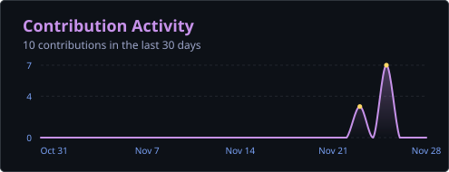

<h1 align="center">Hey 🧑‍💻 I'm Akshay Yadav</h1>

  

## 📌 About Me

> 💡 ✏️ *Full-stack & AI engineer, MS CS @ NYU Tandon. I build full-stack products and AI tools for messy, real-world problems.*

- 🎓 Studying **MS Computer Science at NYU Tandon**
- 🔨 Building **[Penny](https://github.com/codeAkshay21/penny)**, a finance app for students
- 🤖 Also shipped **[ExamPilot](https://github.com/codeAkshay21/ExamPilot)** and **[Product Data Explorer](https://github.com/codeAkshay21/product-data-explorer)**
- 🚀 Open to **Summer 2027 SWE & AI internships**
- 🌐 Portfolio: **[codeakshay.vercel.app](https://codeakshay.vercel.app)**

## 📊 GitHub Stats

  
  

  
  

## 🛠️ Languages & Tools

### Programming Languages

### Frontend

### Backend

### Database

### AI & ML

### DevOps & Cloud

### Tools

## 🔗 Connect with Me

  
  
  
  
  

  <picture>
    <source media="(prefers-color-scheme: dark)" srcset="https://raw.githubusercontent.com/codeAkshay21/codeAkshay21/output/github-snake-dark.svg" />
    <source media="(prefers-color-scheme: light)" srcset="https://raw.githubusercontent.com/codeAkshay21/codeAkshay21/output/github-snake.svg" />
    
  </picture>

